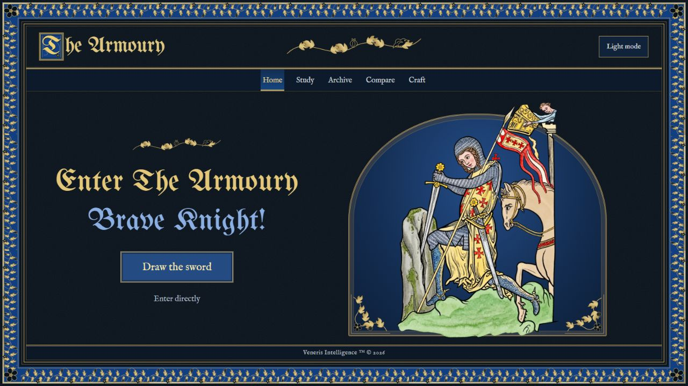
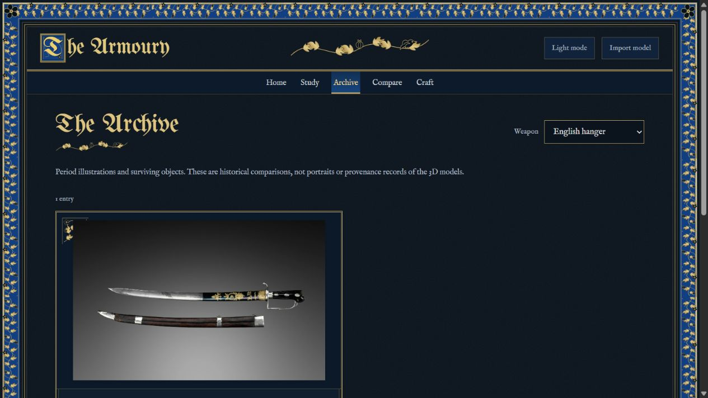

# The Armoury

An interactive collection of thirteen weapon models, presented as an illuminated manuscript. Take a sword apart, inspect its fittings, compare its silhouette with another weapon, and explore historical illustrations and museum records.



## Explore

- **Home:** a six-pose illustrated sword-drawing entrance, with illuminated blackletter lettering, light/dark palettes, floating gold dust and direct entry. Reduced-motion preferences skip the sequence. The 3D application loads only after leaving Home.
- **Study:** animated separation and reassembly, individual piece isolation, 77 finer-detail landmarks, all-part callout labels in assembled and separated views, mesh view and automatic rotation.
- **Archive:** eight zoomable manuscript illustrations and museum photographs, with dates, collection records and image licenses.
- **Compare:** two selectable models with linked rotation and zoom, independent viewing, and a reset control.
- **Craft:** six sourced studies of hilt assembly, quillons, decoration, Japanese mountings, yatagan grips and carrying fittings, plus a reading room.

Light and dark themes are included. Study fits the viewport; the other tabs retain their scrolling document layout. Selecting a part can animate the camera to a close-up; disable **Close-up on selection** to read its information while viewing the complete assembly. **Reset position** restores the camera and shows all pieces while preserving the separation amount.

## Run locally

Use Node.js 22 or later. No package installation or build is needed.

```sh
git clone https://github.com/voltcap/The-Armoury.git
cd The-Armoury
npm start
```

Open **http://127.0.0.1:4173**. To choose another port, set the `PORT` environment variable before starting the server. Use the local server rather than opening `index.html` as a file.

The browser loads its code, models, fonts and images from this project. There are no accounts, access keys, analytics, hosted integrations or external runtime services. Museum links open only when followed. Theme and close-up preferences are stored in the browser. Imported models stay in browser memory and are not uploaded or saved by the application.

## Controls

| Action                               | Control                                    |
| ------------------------------------ | ------------------------------------------ |
| Rotate                               | Drag the model                             |
| Zoom                                 | Mouse wheel or pinch                       |
| Pan                                  | Right-drag or two-finger drag              |
| Separate or assemble                 | Separation slider and assembly buttons     |
| Inspect a part                       | Select a piece row, label or model surface |
| Isolate selected piece               | Gold **Isolate** button or **I**           |
| Restore camera                       | **Reset position** or **R**                |
| Next / previous selection            | Right / left arrow                         |
| Toggle separation                    | Space, when a control is not focused       |
| Leave isolation / close image viewer | Escape                                     |

The Home page’s **Draw the sword** button plays the entrance and opens Study. **Enter directly** bypasses the sequence; Home remains available from the navigation. Links to `#study`, `#archive`, `#compare` and `#craft` still open those sections directly.

Comparison has its own **Reset views** button. Clear **Link rotation & zoom** to orbit either model independently. The comparison normalizes the models to the same viewing span; it does not claim a shared physical scale.

## Collection

The collection includes a longsword replica, Italian arming sword, Roman gladius, Arabic saber, Ottoman yatagan, fantasy dragon katana, Irish Guards sword, Anglo-Saxon T-axe and steel mace, alongside four historical specimen scans by the Oakeshott Institute:

| Specimen | Documented date | Collection context |
| --- | --- | --- |
| [Bronze Age sword OC078](https://sketchfab.com/3d-models/bronze-age-sword-7c0316ffbfd34c2393fbb4e7663e11aa) | 15th century BCE | Oakeshott Collection |
| [Moonbrand](https://sketchfab.com/3d-models/moonbrand-early-14th-c-arming-sword-80fa91fc8c974fd0acd2a55cc513edec) | Late 13th–early 14th century | Privately owned, in the Institute’s care |
| [Milanese rapier](https://sketchfab.com/3d-models/milanese-rapier-b6a87326689545728e1725c62693a9a2) | 1560–1580 | Private collection |
| [English hanger OC059](https://sketchfab.com/3d-models/18th-century-english-hanger-b52dd3d83d44491fadd4261b533a3c4d) | London hallmark, 1795, on the hilt | Oakeshott Collection |

The T-axe is contextualized as a woodworking tool. The Arabic-titled model is sheathed. The dragon katana is a fantasy design using historical Japanese terminology. The historical scans are identified separately from modern replicas and fictional designs; their object descriptions are attributed to the Institute.

## Historical sources

Historical text is based on museum collection records, technical essays, catalogues and archaeological publications. The reading room links books including _The Art of Chivalry_, _Islamic Arms and Armor in The Metropolitan Museum of Art_, _The Academy of the Sword_ and _Art of the Samurai_.

Each feature has a supporting source link. Museum-object dates and descriptions remain attached to their specific comparisons; they do not establish a model's date, materials, dimensions or provenance. Manuscript illustrations are interpreted as period images, including literary and instructional contexts.

See [Sources and further reading](docs/SOURCES.md) and [Historical method](docs/HISTORICAL_METHOD.md). The books themselves are not redistributed here.



## Geometry

The app keeps source components where available. Merged surfaces are divided with planar triangle clipping, preserving interpolated texture coordinates and normals. Closed intersection contours receive neutral cut faces. Incomplete contours remain open.

These are educational surface separations. They cannot reveal hidden tangs, fasteners, cores or authentic manufacturing joints that are absent from a model. Features such as fullers, quillons and grip wrapping remain regions of their parent piece.

**Import model** accepts self-contained binary glTF files (`.glb`, up to 150 MB). It estimates a sword's long axis and four surface regions. Adjust the hilt boundary or reverse the orientation as needed. This provisional segmentation is intended for sword-shaped models, not arbitrary objects. External resource references are rejected.

## Model loading and optimization

Models load on selection. A shared cache reuses downloaded and decoded scenes across Study and Compare, evicts unused models when the cache exceeds three entries, and protects any model still in use by a viewer. Comparison code loads only when its tab is opened. Both comparison windows and Study share the same surrounding lights, environment and camera fill lights.

The thirteen display GLBs total **43,124,492 bytes**, down from **72,397,272 bytes** for their source files (**40.43% smaller**). The original nine models alone are **39.42% smaller**. Compression preserves sword vertex data, topology and world transforms. Base color images use quality-90 WebP; normal and packed material maps use lossless WebP. No sword geometry was simplified or texture resolution reduced. Unused annotation and scale helpers were removed from the Bronze Age and Moonbrand scans.

The decoder is vendored locally. [Optimization records](dist/models/optimization.json) include before/after sizes, hashes and verification details. Optional reproducible preparation scripts live in [tools/model-optimization](tools/model-optimization/README.md); they are not required to run the website. Transfer savings are measured file-size changes, not a claim about a particular device’s loading time.

## Project structure

```text
dist/                    Static application; publish this directory
  main.js                Lightweight entrance and deferred exhibit loading
  home.js / home.css     Six-pose entrance animation and manuscript layout
  camera-state.js        Camera/projection tracking for synchronized redraws
  app.js                 Study viewer and part interaction
  catalog.json           Editable collection names and visible parts
  model-assets.js        Shared GLB loader and resource ownership
  model-cache.js         Bounded shared model cache
  exhibit-lighting.js    Common studio lighting and materials
  clean-cut.js           Planar surface clipping and cut caps
  label-layout.js        Collision-aware callout placement
  compare.js             Paired 3D viewers
  suite.js               Archive, navigation and craft
  *.json                 Editable historical and display content
  data.js, research.js   Bundled content modules
  models/                Original GLBs, transforms and credits
  assets/                Local fonts, border and archive images
  vendor/                Three.js r160 and supporting modules
scripts/build-data.mjs    Rebuilds content modules from JSON
tests/                   Geometry, content, asset and server checks
server.mjs               Local static preview server
```

After editing JSON content, run:

```sh
npm run content
npm run check
npm test
```

Tests check cut planarity, area preservation, texture-coordinate continuity and closed caps; source-module consistency; source coverage and feature links; image licenses and file integrity; original model checksums and embedded resources; and static-server routing. Visual interaction checks are still needed after changes to the viewer. See [Contributing](CONTRIBUTING.md).

## Hosting

Publish the contents of `dist/` to any static web host with HTTPS. Preserve the directory structure and serve JavaScript as JavaScript and `.glb` files as binary assets. There is no application backend or build step. The Node server is a loopback-only development preview.

## Licenses

Original application code is **MIT**. Third-party assets retain their individual terms; see [Credits](CREDITS.md).

Eight models specify **CC BY 4.0**. The **Irish Guards sword specifies CC BY-NC 4.0**, including its noncommercial restriction. The code license does not override that restriction. Archive images are CC0 except the Royal Armouries I.33 image, which is CC BY 4.0. Library and font license texts are included.
